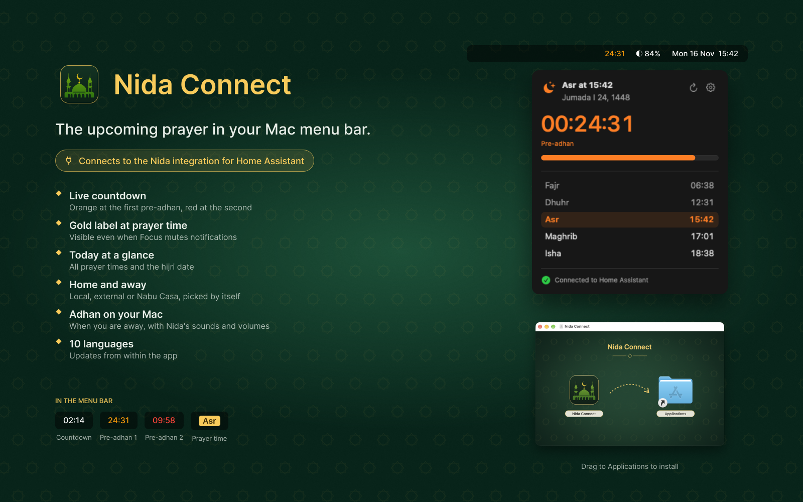

# Nida Connect

  
  
  
  
  

  English · Nederlands · Deutsch · Français · Español · 日本語 · 简体中文 · العربية · Türkçe · Bahasa Indonesia

A tiny macOS menu bar app that shows the **upcoming prayer** with a live countdown. It connects to the **[Nida](https://github.com/joohann/Nida) integration for Home Assistant** and uses its prayer times and settings, or runs **standalone** with prayer times from Aladhan and sounds from the Nida library. It can notify you at the pre-adhan and the adhan, shows a **gold label at prayer time**, and plays the adhan on your Mac when you are away from home.

  

## Features

- Menu bar: `02:14`, under an hour `47:09`; orange at the first pre-adhan, red at the second, a gold label with the prayer's name at prayer time. Icon and prayer name are optional.
- Panel: countdown, today's prayer times, hijri date. Settings on the back of the card.
- Notifications at pre-adhan 1, pre-adhan 2 and the adhan.
- Standalone, without Home Assistant: your place or a place you search, a calculation method, pre-adhan minutes and sounds from the Nida library, all set in the app.
- 10 languages, follows your macOS language.

## Requirements

- macOS 13 or later
- Home Assistant with the Nida integration, or nothing else when you run it standalone

## Setup

At first launch a short setup opens. Choose Home Assistant or standalone. With Home Assistant, the app finds Home Assistant on your network by itself; otherwise enter the address (for example `http://homeassistant.local`). Then sign in with Home Assistant's own login page, or use a long-lived access token. Credentials are stored in the Keychain. Use https outside your home network.

The app reads Nida's sensors through the entity registry, so renamed entities keep working, and reads the pre-adhan minutes from Nida's settings.

## License

MIT
